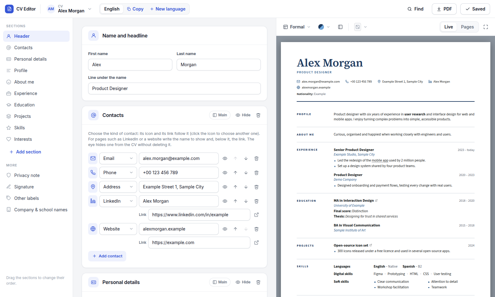
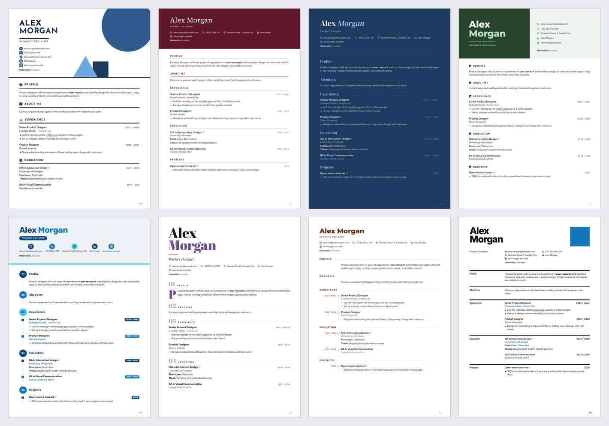

# CV Editor

Write a CV once and export it as PDF in several languages, 50 styles, 16 colours, with or without a
sidebar and with any of your photos.
Everything is edited from a small local web editor with a live preview; each person's CV is kept in
plain-text files and can be exported to (and imported from) a `.zip` file.

It works for any number of people: every CV lives in its own folder in `cvs/`.
CVs and PDFs contain personal data, so `cvs/` and `PDF/` are **never committed to git**: they stay on your
computer. Use **Export** to keep a backup or to move a CV to another computer.





## Quick start

You need Python 3.11+ and Chrome or Chromium. Then:

```bash
git clone https://github.com/elisabetta115/cv-editor.git
cd cv-editor
python3 src/editor.py
```

(Without git: **Code → Download ZIP** on GitHub, unzip it and run `python3 src/editor.py` in the folder.)
Nothing else to install, no account: the editor runs on your computer only. See *Install* below for the
applications-menu shortcut and the optional extras.

## Open the editor

Look for **CV Editor** among your applications (see *Install* below), or run from the project folder:

```bash
python3 src/editor.py
```

Your browser opens with the content on the left and the CV on the right.
Keep the small terminal window open while you work: closing it closes the editor.
The first time, with no CV yet, a welcome screen lets you create your CV, import a `.zip`
file or try the example.

To see the editor as a new user does, without touching your CVs:

```bash
python3 src/editor.py --demo
```

It starts empty, in a temporary folder that is deleted when you close it.

## The editor at a glance

- **Top bar**: the **CV menu** (your CV, with its initials, top left), the **languages** of the CV with
  **Copy** and **+ New language**, and on the right **Find**, **PDF** and **Save**.
- **Left, the sections**: click one to edit it in the middle; drag them to change their order.
- **Middle, the section you edit**, with *previous* and *next* at the bottom.
- **Right, the preview**, with the design bar above it: **Style**, **Colour**, **Sidebar**, **Photo**,
  **Frame**, *Live* / *Pages* and full screen.

## CVs: one per person

The **CV menu** (top left) lists every CV by name: click one to open it, or on the 🗑 next to it to delete
it. Below:

- **New empty CV**.
- **Duplicate this CV…**: a copy of the CV on screen, with the same languages (untick the ones you do not want),
  colours and photos, under a new name, e.g. *Jane Doe – Marketing*: the copy opens at once and what you change
  there does not touch the original. The name is only the name in this menu; the name in the CV (and in the
  PDF file) stays the one you wrote in it. Unsaved changes are saved first.
- **Import a CV (.zip)**: adds the CVs contained in a `.zip` file exported by the editor. A `.zip` you made
  yourself of the `cvs` folder, or of one CV's folder, works too. If a CV with the same name already exists
  you can replace it or keep both. You can also **drag the `.zip` file onto the editor** (anywhere, the
  welcome screen too) instead of choosing it.
- **Export this CV (.zip)**: the CV with every language, the chosen colours and the photos (untick *include
  the photos* to leave them out): its folder, exactly as it is in `cvs/` (`cvs/<name>/content_en.toml`,
  `settings.toml`, `photos/`). Keep it as a backup or send it to someone. **Export every CV (.zip)** puts all
  your CVs in one `cvs.zip`.
- **Delete only the … version** (one language of the CV, the others stay) and **Delete this CV** (every
  language). Before deleting, the editor asks you in a window. When you delete the last CV, the editor goes
  back to its welcome screen.

## Editing a CV

- **Sections** (left): **Header** holds your name and headline, **Contacts** and **Personal details**; then
  come the other sections. Drag them to put them in any order. Hovering one shows two small buttons: the
  **sidebar** button puts it in the sidebar, the **eye** hides it from the CV (its content is kept). Below
  them, **Privacy note**, **Other labels** and **Company & school names**.
- **Edit**: click an entry (a job, a degree…) to open it and type. **Add entries** with **+ Add experience**,
  **+ Add qualification**, **+ Add language**, **+ Add contact**… Move entries with the arrows, delete them
  with the bin: the editor asks first (not for a row left empty), and *Undo* right after brings it back.
- **Rename a section**: click its title and type. Its card also has **Sidebar / Main**, the arrows, **Hide**,
  the bin, and for added sections the copy to another language.
- **Remove a section**: the bin on a section's card (Experience, Interests, Contacts, Personal details… any
  section) removes it from the CV in the language on screen, after asking. *Undo* brings it back; when you
  save, its content is deleted. To have it again, **Add section** lists the sections you removed (Contacts and
  Personal details also under the header).
- **Hide a detail**: every personal detail, contact, language, table row and entry (a job, a degree…) has an
  **eye**: it hides it from the CV without deleting it, e.g. your nationality or date of birth. In the editor
  it stays greyed out; the eye shows it again. The bar at the top then offers to hide it in the other
  languages too (same place, *Copy as is*).
- **Hide one line of a list**: under the box of the digital and soft skills, of a description (each bullet
  point), of a bullet list and of tags, every line is a small chip with an eye (*In the CV: …*): click it to
  hide that line from the CV; it stays in the box, and a second click shows it again. Changing the text of a
  hidden line shows it again. Each language hides its own lines.
- **Hide or delete the privacy note**: **Hide** on the *Privacy note* page (or the eye next to it in the list on
  the left) keeps its text but leaves it out of the CV, only in the language on screen (`hidden = true` in
  `[privacy]`). The bin deletes it, after asking: its text goes and it leaves the list (`removed = true`);
  **Add section** brings it back, empty.
- **Sidebar**: one choice for every style. **Sidebar** in the design bar gives every style a sidebar with
  Contacts, Personal details, About me and Skills (move sections in or out of it with their sidebar button);
  press it again and every section goes back to the main column. Without a sidebar, Contacts and Personal
  details sit in the header.
- **Add section** (Projects, Certifications, Volunteering…), below the sections: choose what it contains,
  *free text*, *bullet list*, *entries with dates* (like experience), *tags* (short words in a row) or a
  *table* (name → value); it goes after the section you are editing. A section can mix several of them.
- **Every language has its own sections**: adding, moving, hiding, deleting a section or putting it in the
  sidebar changes only the language on screen. To bring a section you added to another language, use its copy
  button (it asks before replacing what that language already has there).
- **Bring your changes to the other languages**: when you change something in one language (a text, a new
  entry, a deleted one), a bar at the top asks *“You changed 3 things in English. Also change them in
  Italiano?”* (in Italiano: *“English has 3 changes that are not in this version yet”*). **Review…** lists them,
  each with the new text and what the other language has now: tick the ones you want and press **Translate and
  apply** (with the translator chosen in **+ New language**) or **Copy as is**. Each change goes to the same place
  there (the same entry, in the same position); names, companies, links and contacts are copied, never
  translated. **Only in English** keeps them only where they are. You can undo it, and nothing is saved until
  you press **Save**.
- **Translate a section**: a section copied from another language asks *“This section is still as in English.
  Translate it into Italiano?”* (and one that is there but empty: *“This section is only in English…”*):
  **Translate** fills it in with the translator chosen in **+ New language** (you can undo it), **Not now** /
  **Keep it as it is** leave it as it is.
- **Company & school names** (in the list of sections, and *Rename a company / school everywhere…* under
  Experience and Education; also *Change the names* in the message after an automatic translation) lists every
  company, university and school of the CV, with where it is used (*1 job, 1 degree · mentioned once in the
  text*). Write a new name next to one and it changes everywhere in that language, e.g. *Sapienza University
  of Rome* → *Sapienza Università di Roma*. The other languages stay as they are.
- **Find and replace**: **Find** in the top bar, or Ctrl+F, opens a bar above the section you edit. Type some words:
  they are looked for in every box of the CV in the language on screen, the list of sections shows how many times
  each section has them, and Enter goes from one to the next (Shift+Enter goes back), opening its section and its
  entry and marking the words in their box. Write the new words in *Replace with*: **Replace** changes the words
  marked and goes to the next ones, **Replace all** changes all of them (you can undo it). **Aa** matches capital
  letters, **ab** only whole words. Link addresses (`https://…`, the *Link* boxes) are left out, so that replacing a
  word does not break a link: the 🔗 button includes them. Ctrl+H opens the bar with the cursor in *Replace with*
  (words selected in a box become the words to find); Esc closes it and leaves the words selected in their box. The
  other languages are not changed: the bar at the top then offers to bring the changes to them.
- **Descriptions**: each line is a bullet point in the CV (a single line too). `**bold**` and `*italic*` work.
- **Links**, in any section: select some words in a text box (profile, a description, a list, tags, a table, personal
  details…) and press **Add a link** under it, or Ctrl+K; write the address and the words become a link: underlined
  in the CV, clicking them in the PDF opens the page. With the cursor in a link, Ctrl+K changes or removes it.
  In the text a link is written `[words](https://…)` (you can type it like that too), and an address written as it is
  (`https://…`, `www.…`) is a link by itself. **Experience**, **Education** and the entries of added sections also
  have a **Link** field: the title of the entry becomes clickable, with a small arrow. Automatic translation
  translates the words of a link and keeps its address.
- **Contacts**: choose the kind of each one: *Phone, Email, Address, Website*; *LinkedIn, GitHub, GitLab,
  Stack Overflow, Behance, Dribbble*; *ORCID, Google Scholar, ResearchGate*; *WhatsApp, Telegram, X, Instagram,
  Facebook, YouTube*. For pages (LinkedIn, a website…) write the *name to show* and, below it, the *link*: the
  PDF shows the name, and clicking it opens the link (the button next to it opens it to check it). Some make
  the link themselves: email and phone, the number for WhatsApp, the iD for ORCID, the user name (`@jane.doe`)
  for X, Instagram, Telegram, GitHub and GitLab.
- **Contact icons**: each contact shows the icon of its kind. Click the icon next to a contact to choose
  another one (mobile phone, home, chat, link, calendar…) or *No icon*; *Automatic* goes back to the icon of its
  kind.
- **Style**: in the design bar, it opens the 50 styles, each one showing a small picture of *your* CV in it.
  Type in the search box to find them by name or by what they look like (*serif*, *dark*, *round photo*,
  *timeline*, *academic*, *ats*…), or pick a group: *Classic & formal*, *Clean & modern*, *Bold & creative*,
  *Themed*. Click a style to see it in the preview (the list stays open next to it, to compare), or browse with
  the arrow keys; Enter chooses, Esc closes. **Colour** picks one of 16 palettes; each style remembers its colour.
- **Languages**: switch language at the top. **+ New language** creates the CV in a new language by copying the
  content of a language you already have: you translate the text, section titles are already translated for
  Italian, English, Spanish, French, German, Portuguese and Dutch. Tick **Translate it automatically** and the
  text is translated for you (see *Automatic translation* below). **Undo**, in the message that appears, removes
  the new language again; later, delete one language with **Delete** next to it in **+ New language**, or with
  **Delete only the … version** in the CV menu. The copy button of an entry or of a section copies it to
  another language.
- **Another version in the same language**, in the same CV: e.g. *English (Ireland)* next to *English*, to follow
  another country's rules or to aim at another job. Press **Copy** (at the top, next to the languages), choose
  the language to copy and write what it is for (*Ireland*): the copy gets its own tab at the top. It starts as
  a copy, then you change it as you like (e.g. remove *Personal details*, hide the date of birth, choose
  *No photo*): the other versions are not changed, and the bar that brings changes to the other languages leaves
  it out (the copy buttons of an entry and of a section still copy them to it). Its PDF is called
  like the language's (`CV_Jane_Doe_EN.pdf`); it is exported with the CV, and deleted like a language.
- **Photo**: in the design bar, it shows the photo you see and opens your photos: click one (or *No photo*)
  to choose the version you see, **Add** adds photos, the ✕ on a photo removes it. Large photos are shrunk and
  rotated upright.
- **Frame the photo**: with a photo chosen, **Frame** (next to the photo) opens a panel: click or drag on the
  photo where you want its middle, or use the sliders (*Zoom*, *Left ↔ right*, *Up ↕ down*); the light part is
  what the style on screen shows, and the preview follows. **Shape** gives the photo another shape than the
  style's: *Rectangle*, *Rounded*, *Square* or *Circle* (*As the style* keeps the style's own: round, hexagon,
  octagon...); the size, border and colours of the style stay. **Reset** goes back to how each style frames and
  shapes it. Framing and shape are kept for that photo, in every style and language of the CV (Save keeps
  them). Zooming in needs Pillow (`pip install pillow`).
- **Signature**: in **More** → **Signature** (in the list on the left), **Add your signature…** takes a PNG or JPG
  (a photo or a scan of your signature on white paper is fine) or a PDF (its first page). The editor cuts the
  signature out of the page and makes the paper transparent (with Pillow; a PDF also needs Poppler, MuPDF or
  Ghostscript, e.g. `sudo apt install poppler-utils`). **Sign the CV in …** puts it at the end of the CV, under
  the privacy note, on the right: each language, and each copy, chooses whether it is signed (the first time,
  the one on screen is). **Replace…** and **Delete the signature** change it for every language. On the dark
  styles (Midnight, Neon) it is drawn in white.
- **Live / Pages**: *Live* follows what you type; *Pages* shows the real pages, exactly as in the PDF.
  A CV takes as many pages as it needs. The full-screen button shows the pages on the whole screen.

When you are done:

- **Save** (or Ctrl+S) saves the content.
- **PDF** downloads the version you are looking at: language, style, colour, sidebar and photo. It is called
  `CV_<first name>_<last name>_<LANGUAGE>.pdf`, e.g. `CV_Jane_Doe_EN.pdf`.

## Automatic translation (free)

**+ New language** → **Translate it automatically** creates the CV in the new language already translated. Read
the result and correct it before saving: it is a machine translation (check especially the words that depend on
your gender, which the translator does not know). Two translators, both free and usable for
any purpose, commercial too:

- **AI on this computer**: an AI model (Qwen3, Apache 2.0 licence) run by [Ollama](https://ollama.com) (free,
  MIT licence). Nothing leaves the computer, there is no account, no key and no limit. It needs about 5 GB of
  disk and 16 GB of memory (8 GB with the smaller model below). With a graphics card a CV takes 5 to 20 seconds
  (the first time after starting the computer, about a minute more to load the model); without one, a few minutes.
  Install it once:
  1. Install Ollama from [ollama.com/download](https://ollama.com/download) (Linux:
     `curl -fsSL https://ollama.com/install.sh | sh`).
  2. Download the model: `ollama pull qwen3:8b` (on a computer with little memory, `qwen3:4b`: faster,
     less accurate).

  The panel says when Ollama or the model is missing, and notices them as soon as they are installed.
- **Microsoft Translator** ([Azure AI Translator](https://azure.microsoft.com/products/ai-services/ai-translator)):
  for computers where the AI is too slow. Its free tier translates 2 million characters a month (a CV uses
  about 5 000); when they are used up it stops until the next month, nothing is paid. Only the text is sent
  (Microsoft does not keep it). It needs your own free key, once:
  1. Create a free Azure account at [azure.microsoft.com/free](https://azure.microsoft.com/free) (it asks for a
     card to check who you are; the free tier is never charged).
  2. In the [Azure portal](https://portal.azure.com/#create/Microsoft.CognitiveServicesTextTranslation) create a
     **Translator** resource with the pricing tier **Free F0** and a region near you (e.g. *West Europe*).
  3. Open it, go to **Keys and Endpoint** and copy **KEY 1** and the **Location/Region** (e.g. `westeurope`).
  4. Paste them in the editor the first time you choose Microsoft Translator.

  The key is checked, then kept only on this computer, in `~/.config/cv-editor/translator.json`: it is never in
  the exported CVs. **Remove the key** in the same panel deletes it. In the demo it is forgotten on closing.

With both, names, contacts, organisations and links stay as they are (and are never sent to Microsoft: in the text
only the words of a link are), and
section titles come from the editor for the languages it knows. Universities and schools keep the name you wrote:
to have them in their original language (e.g. *Sapienza Università di Roma*) in every version, start the new
language from the version that has them so, or correct them once by hand.

---

## For developers

```
cvs/<name>/              one folder per person (not in git)
├── content_<code>.toml  the CV content, one file per language (content_en.toml, content_it.toml…) and per
│                        other version in a language (content_en-ireland.toml: English, "en-ireland")
├── settings.toml        the colour chosen for each style and the framing of each photo
├── signature.png        the signature (optional): at the end of the CVs whose content has [signature] show = true
└── photos/              every photo here becomes a PDF version
PDF/<name>/<language>/   the PDFs built from the terminal (not in git)
examples/                an example CV to import
docs/                    the project's web page (GitHub Pages) and the screenshots
tests/                   the tests (see Tests below)
src/
├── editor.py            the command that opens the editor (the code is in cv_editor/)
├── editor.html          the editor's interface
├── generate_cv.py       the command that builds every version of the CVs (the code is in cv_editor/)
├── cv_editor/           the code, one module per job (Python standard library only; Pillow optional):
│   ├── server.py        the editor's local web server: every request is one line of ROUTES
│   ├── actions.py       what the editor asks for: read, preview, save, PDF, new CV, photos… (no web code)
│   ├── transfer.py      export and import: the example .json file and .zip files
│   ├── translator.py    automatic translation: local AI (Ollama) or Azure AI Translator
│   ├── workspace.py     where the CVs are kept (the workspace in use) and the folders of the project
│   ├── storage.py       CVs on disk: one folder per person; reading and writing its content files and settings
│   ├── language.py      the known languages, language codes, the languages of a CV
│   ├── content.py       a CV's content: its sections, their order, what is hidden; an empty CV
│   ├── text.py          text as HTML: **bold**, *italic*, links, only safe addresses
│   ├── contacts.py      kinds of contact, their links and icons
│   ├── render.py        the CV as an HTML page: one page structure for every style
│   ├── styles.py        the styles (src/styles/) and the colour palettes
│   ├── photos.py        photos and the signature: saving, finding, framing, smaller copies for the pages
│   ├── pdf.py           printing the pages to PDF with headless Chrome
│   └── build.py         building every version of a CV (the generate_cv.py command)
├── styles/              base.css, fonts.css and one stylesheet per style
├── fonts/               bundled fonts (SIL Open Font License)
└── html/                generated pages used to print the PDFs (not kept in git)
```

- Build every version at once (every language, style and photo) without the editor:
  `python3 src/generate_cv.py` (options: `--cv "Jane Doe"`, `--language en`, `--style modern,swiss`,
  `--photo photo2`, `--photo 0` = no photo, `--html-only`, `--data /path/to/folder` for CVs kept in another
  folder, as with the editor). Without `--cv` every CV is built. With 50 styles
  that is many PDFs per language and photo: `--style` builds only the styles you name.
- **Where the CVs are**: the `Workspace` in `src/cv_editor/workspace.py` holds the folders in use (`cvs/`, `PDF/`, the
  generated pages) and whether this is the demo; `workspace()` gives the one in use, `use_workspace()` changes it
  (`--data`, `--demo`, the tests). Nothing else in the code says where the CVs are.
- **The editor's requests**: one line each in `ROUTES` (`src/cv_editor/server.py`): method, address, the function
  that answers (from `actions.py`, `transfer.py` or `translator.py`, which know nothing about the web) and whether
  it waits for the lock (requests that read or write CV files take turns). The server answers only this computer,
  and every request but `/api/ping` needs the secret token that the editor's page carries.
- **Exported `.zip`**: the files of `cvs/<name>/` as they are on disk, under `cvs/<name>/` in the zip.
  On import, every folder of the zip that holds `content_<code>.toml` files is one CV, named after the
  folder (or after the person, when the files are at the top of the zip); its `settings.toml`,
  `signature.png` and `photos/` come with it, other files are ignored. Content files are normalised and rewritten
  (and the signature cut out again).
- **The example** ([`examples/example-cv.json`](examples/example-cv.json)), opened by *Try the example*:
  `{"format": "cv-editor", "version": 1, "name", "settings", "languages": {code: content}, "photos": [{"name",
  "data": "data:image/jpeg;base64,…"}]}`. The content of each language has the same structure as the `.toml` files.
- **Content files** can also be edited by hand. Main tables: `[person]`, `[[details]]`, `[[contacts]]`
  (`type` = phone | email | address | web | linkedin | github | … see `CONTACT_TYPES` in `src/cv_editor/contacts.py`;
  `icon` = another icon of `ICONS`, or `none`), `[[experience]]`, `[[education]]` (each entry may have a `link`),
  `[[languages]]`, `[skills]`, `[interests]`, `[privacy]`, `[labels]` (section titles), `[cv_language]`
  (name of the language) and `[[sections]]`: every section in CV order, either a fixed one
  (`builtin` = contacts | details | profile | about_me | experience | education | skills | interests) or an extra one
  with an `id`, a `title` and any of `text`, `list`, `tags`, `[[sections.entries]]`, `[[sections.rows]]`
  (`label`, `value`). Any section can have `hidden = true` and `column = "side"`: the CV has a sidebar, in
  every style, as soon as one visible section has it. A fixed section taken out of the CV is
  `{builtin = "interests", removed = true}` (without it, a fixed section missing from the list is added back).
  Items of `[[details]]`, `[[contacts]]`, `[[experience]]`, `[[education]]`, `[[languages]]` and of a section's
  `entries` and `rows` can have `hidden = true`: kept in the file, left out of the CV (`prepare` in `src/cv_editor/content.py`).
  Lines of a list are hidden by their text in `<list>_hidden`: `digital_hidden`, `soft_hidden` (in `[skills]`),
  `list_hidden`, `tags_hidden` (in a section) and `description_hidden` (in an entry). `copied_from = "en"` marks an extra section copied from another
  language and not translated yet (the editor offers to translate it). Older files without `builtin` entries are still read.
  Texts can hold links, `[words](address)` or an address written as it is (`MARKDOWN_LINK` and `TEXT_LINK` in
  `src/cv_editor/text.py`, rendered by `rich`): everywhere but names, section titles, organisations, places, dates and contacts.
- **Styles** share one page structure (`render_page` in `src/cv_editor/render.py`): `.cv-header`, an optional
  `.sidebar`, `.main-column`, `.privacy`. `src/styles/base.css` styles every block; each style's stylesheet
  only changes what makes it different, for both `.has-sidebar` and `.no-sidebar` pages.
- **Adding a style** is adding one file, `src/styles/<id>.css`: the comment at its top describes it and the
  editor lists it on its next start. Lines `@name`, `@group` (classic | modern | creative | themed), `@color`
  (the palette it starts with), `@side right` (sidebar on the right), `@tags` (words for the search, separated
  by commas) and, when needed, `@print` / `@print-sidebar`: rules for the printed page that use the palette,
  written with `$dark`, `$mid`, `$light`, `$bg` (CSS variables do not work inside `@page`). The rest of the
  comment is the description shown in the editor. See `load_styles` in `src/cv_editor/styles.py`.
- **Photo framing**: `[photos."<file>"]` in `settings.toml` (`x`, `y` = 0-100, `zoom` = 1-4, `shape` = rect |
  rounded | square | circle; each optional), read by `load_settings` (`storage.py`) and checked by `photo_frame` (`photos.py`). The shape is a
  `shape-*` class on the photo's frame; the rules at the top of `base.css` replace the style's cut-outs, rings
  (`::before`, `::after`) and corners, so a new style needs nothing for it. The position is an inline `object-position` on the ``; the zoom
  is a cut copy of the photo made by `framed_photo` (Pillow), because several styles give the `` itself its
  shape (`clip-path`, round border), so the page cannot simply enlarge it.
- Colour palettes live in `COLORS` in `src/cv_editor/styles.py`; layout and typography in `src/styles/<style>.css`.
  Styles read their colours from the `--p-dark`, `--p-mid`, `--p-light` and `--p-bg` variables.
- Imported files are treated as untrusted: content is normalised and HTML-escaped, only `http(s)`, `mailto`
  and `tel` links are kept, photo names cannot leave the CV folder (paths inside a `.zip` are never used to
  write files), and the preview runs without scripts. An import writes every CV under a new name first and
  replaces the old CV only when all of them were written: a failed import changes nothing.
- The editor listens on `127.0.0.1` only and refuses requests without its per-session token.
- **Automatic translation** (`src/cv_editor/translator.py`): the text of the CV, paragraph by paragraph and each different one once,
  goes either to Ollama's `/api/chat` or to Azure's Translator v3 API (`**bold**` and `*italic*` as `<b>`/`<i>`
  tags, `[words](address)` as `<a id="0">words</a>`: the address stays on the computer and is put back after).
  Ollama sees links as they are written; `_keep_links` puts their addresses back as they were, and a line whose
  translation lost a link keeps its original text. With Ollama, paragraphs of 5 words or more are translated one at a time (and again, up to 3 times,
  when the answer copies the original), shorter ones together as a JSON object whose keys say what each one is
  (`"3: language level": "Native"`); a JSON schema as `format` keeps the answer to exactly those keys.
  The fields in `KEEP` and `KEEP_TOP` (names, contacts, organisations, links) are not translated.
  Section titles known for the new language come from `KNOWN_LANGUAGES`. Environment variables:
  `OLLAMA_HOST` (where Ollama listens), `CV_OLLAMA_MODEL` (another model: check its licence),
  `AZURE_TRANSLATOR_KEY` and `AZURE_TRANSLATOR_REGION` (instead of the saved key), `AZURE_TRANSLATOR_ENDPOINT`
  (e.g. `https://api-eur.cognitive.microsofttranslator.com` to have the text processed in Europe).

### Tests

```bash
python3 -m unittest                        # every test (a few seconds), from the project folder
python3 -m unittest tests/test_render.py   # one file
python3 tests/compare_pixels.py            # after changing a style: the printed CVs, pixel by pixel, against the last commit
```

The tests never touch your CVs: each one works in an empty temporary folder. They cover the HTML of every
style (compared with the fingerprints in `tests/reference/render.json`), saving and reading CVs, `.zip` and
`.json` import and export (damaged and hostile files too), links and text, translation (with a fake translator),
the local server and its security checks, and the editor's page in headless Chrome (skipped without Chrome).
When a change to the pages is intended, update the fingerprints with
`CV_UPDATE_REFERENCES=1 python3 -m unittest tests/test_render.py` and check `git diff`.
`compare_pixels.py` also needs `pdftoppm` (poppler-utils) and Pillow; it saves the differences as images.
GitHub runs the tests at every push (`.github/workflows/tests.yml`).

## Install

- Requirements: Python 3.11+ and Chrome or Chromium. Recommended: `pip install pillow` to shrink large photos.
- Add "CV Editor" to the applications menu (Linux): `python3 src/editor.py --install`
- Keep the CVs and PDFs in another folder: `python3 src/editor.py --data /path/to/folder`
- The bundled fonts cover Western European alphabets: in languages such as Polish, Czech, Romanian, Greek or
  Russian some letters fall back to a different font.

## Licence and credits

CV Editor is free and open source, released under the [MIT licence](LICENSE): you may use, copy, change and
share it, also for commercial purposes, as long as the copyright notice stays with it.

The bundled fonts (SIL Open Font License) and icons ([Lucide](https://lucide.dev), ISC licence) are the work
of their authors: their copyright notices and licences are in [THIRD-PARTY-NOTICES.md](THIRD-PARTY-NOTICES.md)
and [src/fonts/OFL.txt](src/fonts/OFL.txt). None of them limits what you do with the CVs and PDFs you make.
